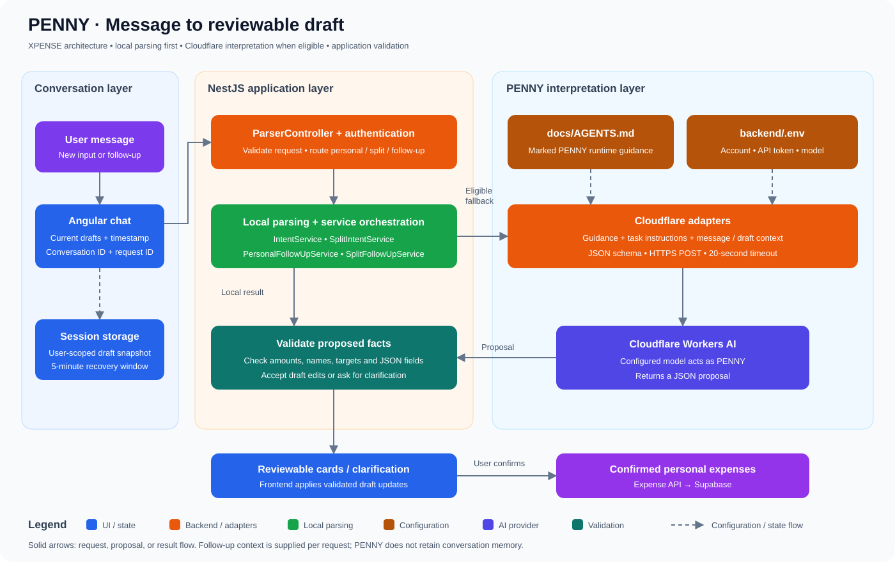

# PENNY model configuration and request flow

## Contents

This guide contains **15 main sections**.

1. [Purpose](#1-purpose)
2. [Architecture block diagram](#2-architecture-block-diagram)
3. [Runtime configuration](#3-runtime-configuration)
4. [How PENNY is initiated](#4-how-penny-is-initiated)
5. [HTTP entry points](#5-http-entry-points)
6. [Personal-expense code flow](#6-personal-expense-code-flow)
7. [Peer-split code flow](#7-peer-split-code-flow)
8. [Cloudflare request structure](#8-cloudflare-request-structure)
9. [How PENNY responds](#9-how-penny-responds)
10. [Conversation context and memory](#10-conversation-context-and-memory)
11. [Important functions](#11-important-functions)
12. [Result metadata](#12-result-metadata)
13. [Failure and fallback behavior](#13-failure-and-fallback-behavior)
14. [Safely changing PENNY](#14-safely-changing-penny)
15. [Security boundaries](#15-security-boundaries)

## 1. Purpose

PENNY is XPENSE's conversational assistant for interpreting personal-expense and peer-split messages. PENNY is not a separately trained or permanently running model. The application gives the configured Cloudflare Workers AI model the PENNY identity on every request by sending:

1. PENNY's behavioral guidance from `docs/AGENTS.md`.
2. Instructions for the current task.
3. The current user message and, when needed, the current draft snapshot.
4. A strict JSON schema describing the only response shape that is accepted.

The model proposes structured facts. It does not save expenses, calculate authoritative balances, or directly modify the database. NestJS validates the proposal, and the user reviews the resulting draft before any persistence occurs.

## 2. Architecture block diagram



[Open the full-size colored diagram](assets/penny-architecture.svg). The image includes grouped application layers, directional arrows, and a color legend.

## 3. Runtime configuration

The backend reads the following variables from the ignored `backend/.env` file:

| Variable | Purpose | Secret? |
|---|---|---|
| `CLOUDFLARE_ACCOUNT_ID` | Selects the Cloudflare account that owns Workers AI. | Treat as private configuration. |
| `CLOUDFLARE_AI_API_TOKEN` | Authorizes the backend to call Cloudflare Workers AI. | Yes. Never send it to the frontend or commit it. |
| `CLOUDFLARE_AI_MODEL` | Selects the Cloudflare model. The code defaults to `@cf/google/gemma-4-26b-a4b-it`. | No. |
| `SUPABASE_PROJECT_ID` | Identifies the Supabase environment used by the backend. | No, but keep environment configuration together. |
| `SUPABASE_URL` | Base URL for Supabase APIs. | No. |
| `SUPABASE_PUBLISHABLE_KEY` | Public client key used with RLS-protected Supabase APIs. | Publishable, but it does not replace RLS. |

The Cloudflare token stays in NestJS. Angular never calls Cloudflare directly and never receives the token.

The backend loads `.env` during startup in `backend/src/main.ts`. `CloudflareIntentSegmenter.isConfigured()`, `CloudflareSplitInterpreter.isConfigured()`, and `CloudflarePersonalFollowUp.isConfigured()` require all of the following before model assistance is available:

- a Cloudflare account ID;
- a Cloudflare API token; and
- readable PENNY runtime guidance.

If any requirement is missing, the model adapter returns no proposal and the application continues with local parsing or clarification.

## 4. How PENNY is initiated

### 4.1 NestJS dependency registration

`backend/src/parser/parser.module.ts` registers the parsing services and Cloudflare adapters as NestJS providers:

- `ParserService` — deterministic personal-expense parser;
- `IntentService` — local-first personal-intake orchestrator;
- `CloudflareIntentSegmenter` — model adapter for unclear multi-transaction boundaries;
- `CloudflareSplitInterpreter` — model adapter for new splits and split follow-ups;
- `CloudflarePersonalFollowUp` — model adapter for edits to personal drafts;
- `SplitIntentService` — local-first new-split orchestrator and validator;
- `SplitFollowUpService` — local-first split-edit orchestrator and validator;
- `PersonalFollowUpService` — personal-edit validator and orchestrator.

The token `INTENT_SEGMENTER` resolves to `CloudflareIntentSegmenter`. This keeps `IntentService` dependent on an interface rather than constructing a Cloudflare adapter itself.

### 4.2 PENNY guidance loading

`backend/src/parser/penny-guidance.ts` implements `loadPennyGuidance()`.

The function:

1. Searches expected development and compiled locations for `docs/AGENTS.md`.
2. Reads the file as UTF-8.
3. Extracts only the text between `PENNY_RUNTIME_START` and `PENNY_RUNTIME_END`.
4. Returns the extracted text or `null`.

Only the marked PENNY runtime section enters Cloudflare requests. Repository editing instructions, testing instructions, and unrelated documentation are deliberately excluded.

### 4.3 Build and deployment

The backend build command is:

```text
nest build && node scripts/copy-penny-guidance.js
```

`backend/scripts/copy-penny-guidance.js` copies the source-of-truth `docs/AGENTS.md` into `backend/dist/docs/AGENTS.md`. This makes the guidance available to compiled production code. If that file is absent or the markers are invalid, the model lane remains unavailable rather than running without its safety guidance.

## 5. HTTP entry points

All parser endpoints are protected by `JwtAuthGuard` in `backend/src/parser/parser.controller.ts`.

| Endpoint | Main service | Purpose |
|---|---|---|
| `POST /parser/parse` | `ParserService` | Deterministic parsing of one personal transaction. It does not call PENNY. |
| `POST /parser/parse-batch` | `IntentService` | Local-first parsing of personal transactions, with narrow AI fallback. |
| `POST /parser/split-intent` | `SplitIntentService` | Creates reviewable split drafts from a new message. |
| `POST /parser/split-follow-up` | `SplitFollowUpService` | Updates participant, payer, amount, or count fields in pending split drafts. |
| `POST /parser/personal-follow-up` | `PersonalFollowUpService` | Updates or deletes pending personal-expense drafts. |

The Angular client in `frontend/src/app/core/parser/parser.service.ts` adds:

- the current user message;
- the browser's IANA timezone;
- a reference timestamp;
- `X-Conversation-Id`; and
- a new `X-Request-Id` for the current turn.

`backend/src/request-trace.ts` validates both IDs as UUID v4 values. It generates missing IDs for backward compatibility. The IDs are returned with the response and included in decision logs.

## 6. Personal-expense code flow

### 6.1 First message or batch message

`IntentService.analyze()` controls `POST /parser/parse-batch`:

1. Calls `ParserService.parseBatch()` first.
2. Marks the initial result as `interpretationSource: "LOCAL"`.
3. Returns immediately when the message is a greeting.
4. Returns the local result when it is already sufficient.
5. For a single incomplete draft, it may ask `PersonalFollowUpService` to fill only missing fields.
6. For an unclear multi-amount message, it may ask `CloudflareIntentSegmenter` for transaction boundaries.
7. Aligns every proposed segment with exact, contiguous text from the original message.
8. Runs the segmented text through `ParserService` again.
9. Accepts the model-assisted result only when it improves the local result and every draft still has an amount.

Cloudflare does not become the accounting parser. It helps find boundaries or propose missing facts; deterministic code still produces and checks the transaction drafts.

### 6.2 Personal follow-up

For a message such as `delete the expense for 3000`:

1. Angular sends the message plus the current unsaved draft snapshot to `/parser/personal-follow-up`.
2. `PersonalFollowUpService.analyze()` validates the supplied draft context.
3. `CloudflarePersonalFollowUp.interpret()` proposes an `UPDATE` or `DELETE` against a draft ordinal.
4. `PersonalFollowUpService.validate()` confirms that the target exists and the proposed values are grounded in the current message.
5. A delete is accepted only when the user used a delete word and the amount or transaction number identifies the draft safely.
6. The frontend applies an accepted update to its reviewable draft state. Nothing is saved automatically.

## 7. Peer-split code flow

### 7.1 New split intent

`SplitIntentService.analyze()` controls `/parser/split-intent`:

1. `extractLocal()` first recognizes explicit numbered splits with amounts and people counts.
2. If local parsing succeeds, the result is returned without a model call.
3. Otherwise, `CloudflareSplitInterpreter.interpret()` asks PENNY to propose split drafts.
4. `SplitIntentService` validates that every amount, participant, payer, beneficiary, and count is supported by the user's text.
5. The service converts accepted money values to integer minor units.
6. An invalid, incomplete, contradictory, or invented proposal is rejected and produces a clarification prompt.

### 7.2 Split follow-up

`SplitFollowUpService.analyze()` controls `/parser/split-follow-up`:

1. Validates the pending split snapshot received from Angular.
2. Tries `parseLocal()` for explicit forms such as `Use Jashu and Harsha for split 1`.
3. If local parsing fails, calls `CloudflareSplitInterpreter.interpretFollowUp()`.
4. Validates ordinals, participant counts, names, payer, amount, and grounding in the current message.
5. Returns only validated field updates for the frontend to merge into its pending cards.

The current draft snapshot is what gives PENNY follow-up context. The model does not remember earlier API calls by itself.

## 8. Cloudflare request structure

All model adapters call this endpoint from the backend:

```text
POST https://api.cloudflare.com/client/v4/accounts/{accountId}/ai/v1/chat/completions
Authorization: Bearer {CLOUDFLARE_AI_API_TOKEN}
Content-Type: application/json
```

The real token is never placed in documentation, logs, frontend code, or API responses.

A simplified split-follow-up request looks like this. The actual `json_schema` contains the complete field definitions and validation rules:

```json
{
  "model": "@cf/google/gemma-4-26b-a4b-it",
  "stream": false,
  "temperature": 0.3,
  "max_completion_tokens": 1024,
  "chat_template_kwargs": {
    "enable_thinking": false
  },
  "response_format": {
    "type": "json_schema",
    "json_schema": {
      "type": "object",
      "additionalProperties": false,
      "required": ["updates"]
    }
  },
  "messages": [
    {
      "role": "system",
      "content": "You are PENNY ..."
    },
    {
      "role": "system",
      "content": "Map the current follow-up to pending numbered split drafts ..."
    },
    {
      "role": "user",
      "content": "{\"message\":\"Use Jashu and Harsha for split 1\",\"pendingSplits\":[...]}"
    }
  ]
}
```

The three message layers have different jobs:

| Message | Responsibility |
|---|---|
| First system message | Defines PENNY's identity and permanent safety behavior. |
| Second system message | Defines the current task and field-level rules. |
| User message | Supplies the current text and the minimum draft context needed for this turn. |

### Request controls and response measurements

Some values configure the request before it is sent. Token usage values are measurements returned by Cloudflare after generation.

| Field | Kind | Meaning for PENNY |
|---|---|---|
| `model` | Request parameter | Selects the Cloudflare-hosted model that acts as PENNY. |
| `stream: false` | Request parameter | Waits for one complete response. With `true`, Cloudflare sends partial results as Server-Sent Events. PENNY uses `false` because the backend must parse and validate one complete JSON document. |
| `temperature: 0.3` | Request parameter | Allows limited variation when interpreting different phrasings while keeping extraction conservative. |
| `max_completion_tokens: 1024` | Request parameter | Sets the maximum number of tokens Cloudflare may generate for this response. It is a ceiling, not the normal response size or a guaranteed charge. |
| `chat_template_kwargs.enable_thinking: false` | Model-specific request parameter | Disables Gemma's built-in thinking mode. This keeps PENNY's extraction calls faster and focused on the required JSON. Enabling it can help with difficult reasoning tasks, but may increase latency and generated-token usage. |
| `response_format` | Request parameter | Requires the assistant content to follow the supplied JSON schema. The backend still validates the returned JSON. |
| `messages` | Request parameter | Contains PENNY's guidance, task instructions, and the current message with its draft context. |
| `usage.prompt_tokens` | Response measurement | The actual number of input tokens Cloudflare counted. XPENSE records this as `inputTokens`. |
| `usage.completion_tokens` | Response measurement | The actual number of generated tokens Cloudflare counted. XPENSE records this as `outputTokens`. |
| `usage.total_tokens` | Response measurement | The provider-reported total token usage for the call. |

`inputTokens` is not sent in the request. It is XPENSE's monitoring name for Cloudflare's returned `usage.prompt_tokens`. Input tokens include the system guidance, task instructions, JSON schema, user text, and supplied draft context.

`max_completion_tokens` and `outputTokens` describe different stages:

```text
Before the request: max_completion_tokens = allowed output ceiling
After the response: outputTokens = actual generated-token count
```

For example, with `max_completion_tokens: 1024`, a valid short JSON response might use only `85` output tokens. If generation reaches the limit before the JSON is complete, parsing or validation will fail and XPENSE will reject the proposal.

Cloudflare documents `stream`, `max_completion_tokens`, `chat_template_kwargs`, and the response `usage` object in its [Gemma 4 model reference](https://developers.cloudflare.com/ai/models/%40cf/google/gemma-4-26b-a4b-it/). Its [Gemma getting-started example](https://developers.cloudflare.com/workers-ai/get-started/workers-wrangler/) uses `enable_thinking: false` to disable reasoning for this model.

### Token usage monitoring

Every Cloudflare request writes one structured `cloudflare-ai-usage` event to the NestJS log. `AiMetricsService` also inserts the same measurement into `public.ai_request_metrics` through the current user's Supabase access token. The event and row are correlated with the current conversation and request IDs.

```json
{
  "conversationId": "11111111-1111-4111-8111-111111111111",
  "requestId": "22222222-2222-4222-8222-222222222222",
  "event": "cloudflare-ai-usage",
  "route": "split-intent",
  "model": "@cf/google/gemma-4-26b-a4b-it",
  "outcome": "SUCCESS",
  "httpStatus": 200,
  "inputTokens": 321,
  "outputTokens": 45,
  "totalTokens": 366,
  "usageReported": true
}
```

`inputTokens` comes from Cloudflare's `usage.prompt_tokens`. Failed requests are logged with their request ID and outcome; their token fields are `null` when Cloudflare does not report usage. The log contains no prompt text, model response, JWT, or provider credential. Search backend logs for a request ID or for `"event":"cloudflare-ai-usage"` to inspect usage.

The metrics table exists independently in the development and production Supabase projects. Each row stores:

| Column | Purpose |
|---|---|
| `user_id` | RLS owner derived from the authenticated Supabase JWT. |
| `conversation_id` | Groups all model calls belonging to one conversation session. |
| `request_id` | Correlates the metric with one user turn and its backend logs. |
| `route` | Identifies segmentation, personal follow-up, split intent, or split follow-up. |
| `provider` and `model` | Identify Cloudflare and the configured model. |
| `temperature` | Records the sampling temperature used by that call. |
| `max_completion_tokens` | Records the configured maximum generated-token allowance. |
| `input_tokens`, `output_tokens`, `total_tokens` | Store Cloudflare's actual usage counters when reported. |
| `outcome`, `http_status`, `usage_reported` | Distinguish success, provider errors, transport errors, and missing counters. |
| `created_at` | Supports time-based monitoring and aggregation. |

The table stores no user message, prompt, model response, JWT, or Cloudflare credential. RLS permits authenticated users to insert and select only their own rows; metrics cannot be updated or deleted through the authenticated Data API.

## 9. How PENNY responds

Cloudflare returns an envelope whose first assistant message contains JSON text. Each adapter:

1. Checks the HTTP status.
2. Reads `choices[0].message.content`.
3. Parses the content with `JSON.parse()`.
4. Checks the expected keys and basic types.
5. Returns a proposal to the owning NestJS service.

Example proposal for a personal deletion:

```json
{
  "updates": [
    {
      "ordinal": 2,
      "action": "DELETE",
      "amount": null,
      "date": null,
      "category": null,
      "merchant": null,
      "splitResolution": null,
      "splitFactor": null
    }
  ]
}
```

Example proposal for a new split:

```json
{
  "drafts": [
    {
      "amount": "500",
      "peopleCount": "2",
      "participants": ["You", "Harsha"],
      "paidBy": "Harsha",
      "allocationKind": "EQUAL",
      "beneficiary": null
    }
  ]
}
```

These are proposals, not commands. The application rejects a proposal when, for example:

- an amount does not appear in the user's message;
- a participant name was invented;
- the selected draft ordinal does not exist;
- several drafts match the same deletion target;
- a payer is not a participant;
- a participant count is unsupported;
- unknown properties appear;
- the returned content is not valid JSON; or
- Cloudflare times out or returns a non-success status.

## 10. Conversation context and memory

Cloudflare chat completions are treated as stateless. PENNY receives no reliable memory merely because two calls use the same conversation ID.

XPENSE provides continuity by sending current state with each relevant request:

- `conversationId` identifies the conversation;
- `requestId` uniquely identifies one turn;
- personal follow-ups include the current personal drafts;
- split follow-ups include the current pending splits;
- the browser stores the active intake snapshot in user-scoped `sessionStorage` for five minutes.

The conversation ID is primarily trace and state identity. The draft snapshot is the actual context the model uses to understand phrases such as `the second one`, `change it to 500`, or `use Harsha for split 1`.

The Supabase schema also contains conversation session and turn tables for eventual backend state, but the current conversational frontend code still supplies its active draft snapshot with follow-up requests.

## 11. Important functions

| Function | File | Responsibility |
|---|---|---|
| `loadPennyGuidance()` | `backend/src/parser/penny-guidance.ts` | Extracts only PENNY's runtime section from `docs/AGENTS.md`. |
| `readRequestTrace()` | `backend/src/request-trace.ts` | Validates or generates the conversation ID and request ID. |
| `ParserController.parseBatch()` | `backend/src/parser/parser.controller.ts` | Receives authenticated personal-intake requests and delegates to `IntentService`. |
| `IntentService.analyze()` | `backend/src/parser/intent.service.ts` | Runs deterministic parsing first and narrowly selects model assistance. |
| `IntentService.needsSegmentation()` | `backend/src/parser/intent.service.ts` | Decides whether an unclear multi-amount message qualifies for AI segmentation. |
| `CloudflareIntentSegmenter.segment()` | `backend/src/parser/cloudflare-intent-segmenter.ts` | Requests exact transaction-boundary substrings from Cloudflare. |
| `AiMetricsService.record()` | `backend/src/parser/ai-metrics.service.ts` | Persists one RLS-protected model-call metric using the current user's Supabase access token. |
| `PersonalFollowUpService.analyze()` | `backend/src/parser/personal-follow-up.service.ts` | Validates context, invokes PENNY, and returns safe personal-draft edits. |
| `PersonalFollowUpService.validate()` | `backend/src/parser/personal-follow-up.service.ts` | Grounds every proposed personal update or deletion in the message and draft list. |
| `CloudflarePersonalFollowUp.interpret()` | `backend/src/parser/cloudflare-personal-follow-up.ts` | Sends personal follow-up context and a strict update schema to Cloudflare. |
| `SplitIntentService.analyze()` | `backend/src/parser/split-intent.service.ts` | Chooses local split extraction or model fallback and validates new split drafts. |
| `CloudflareSplitInterpreter.interpret()` | `backend/src/parser/cloudflare-split-interpreter.ts` | Requests structured new-split proposals. |
| `SplitFollowUpService.analyze()` | `backend/src/parser/split-follow-up.service.ts` | Tries local split edits before invoking PENNY. |
| `CloudflareSplitInterpreter.interpretFollowUp()` | `backend/src/parser/cloudflare-split-interpreter.ts` | Requests structured edits to numbered pending splits. |
| `ParserService.createPayload()` | `frontend/src/app/core/parser/parser.service.ts` | Adds the browser timezone and current timestamp to a user message. |
| `requestTraceHeaders()` | `frontend/src/app/core/request-trace.ts` | Adds conversation and request IDs to HTTP headers. |

## 12. Result metadata

Parser responses expose metadata that makes the decision path observable:

| Field | Meaning |
|---|---|
| `interpretationSource: "LOCAL"` | The accepted result came from deterministic application logic. It can also mean a model proposal was rejected. |
| `interpretationSource: "MODEL"` | A validated model proposal contributed to the accepted result. |
| `modelAttempted: false` | No Cloudflare request was needed or possible. |
| `modelAttempted: true` | The backend attempted model interpretation. |
| `modelAccepted: true` | The proposal passed application validation and affected the returned result. |
| `modelAccepted: false` | The model was not called, failed, returned nothing useful, or its proposal was rejected. Inspect `modelAttempted` to distinguish these cases. |

## 13. Failure and fallback behavior

PENNY is optional assistance. The application must remain usable when Cloudflare is unavailable.

| Failure | Application behavior |
|---|---|
| Missing account ID, token, model guidance, or build copy | Do not call Cloudflare; keep the local result. |
| Network error or 20-second timeout | Adapter returns `null`; ask for clarification or use manual entry. |
| Non-2xx Cloudflare response | Reject the response without using it. |
| Invalid JSON or wrong schema | Reject the proposal. |
| Correct JSON containing unsupported facts | Domain validator rejects the proposal. |
| Ambiguous target | Return no update and ask a specific clarification question. |

The adapters currently catch provider errors and return `null`; they do not expose provider error bodies or credentials to the client.

## 14. Safely changing PENNY

When changing PENNY behavior:

1. Put stable, cross-task behavior inside the marked PENNY section of `docs/AGENTS.md`.
2. Put task-specific extraction rules in the relevant Cloudflare adapter.
3. Keep financial calculations and persistence outside the model adapter.
4. Add or change the JSON schema before accepting new output fields.
5. Validate every new field against the user message and current draft state.
6. Add focused tests for the prompt, schema, accepted proposal, rejected proposal, and provider-unavailable fallback.
7. Run the backend build so the documentation guidance is copied into `dist/docs/AGENTS.md`.

Relevant tests include:

- `backend/src/parser/penny-guidance.spec.ts`;
- `backend/src/parser/cloudflare-intent-segmenter.spec.ts`;
- `backend/src/parser/cloudflare-split-interpreter.spec.ts`;
- `backend/src/parser/intent.service.spec.ts`;
- personal and split follow-up service specifications; and
- frontend parser and context-intake specifications.

## 15. Security boundaries

- Never commit `backend/.env`.
- Never send the Cloudflare API token to Angular.
- Never include JWTs, database passwords, service-role keys, or unrelated financial history in a model prompt.
- Never trust a model-returned database ID or persistence instruction.
- Never automatically save a model-created draft.
- Never use model arithmetic as the authoritative split calculation.
- Keep every draft editable and require explicit user confirmation.
- Avoid logging raw financial prompts or raw model responses in production.

The core rule is: PENNY interprets language; deterministic XPENSE code validates facts, calculates money, and controls persistence.
