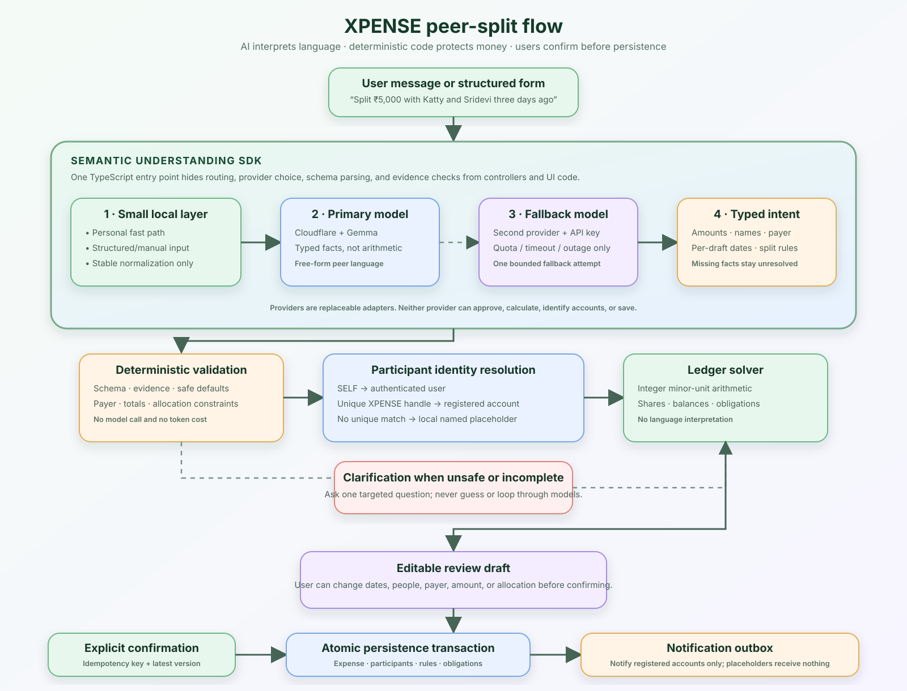

# Peer Split Engine — Architecture Discussion Draft

## Metadata

| Field             | Value                                                                                                                                      |
| ----------------- | ------------------------------------------------------------------------------------------------------------------------------------------ |
| Status            | Phase A complete; Phases C/D prototyping in progress; identity, persistence, notification, and settlement boundaries remain design targets |
| Working branch    | `feature/peer-split-engine-design`                                                                                                         |
| Base branch       | `develop`                                                                                                                                  |
| Builds on         | Milestone 10 deterministic context parser and conversational intake                                                                        |
| Primary objective | Preserve personal expense accuracy while adding multi-party balances and deterministic asymmetric splits                                   |

## 1. Why this document exists

Milestone 10 is a personal transaction intake engine. It is intentionally optimized to answer:

> How much belongs in the signed-in user's personal expense history?

That contract is correct for personal finance, but it is not sufficient for a Splitwise-like peer ledger. A peer expense must also answer:

- Who participated?
- Who paid money at the time of purchase?
- How much should each participant ultimately bear?
- Who owes whom after comparing payment contributions with owed shares?
- How should partial settlements change the outstanding balances?

This proposal keeps Milestone 10 unchanged as the fast personal-expense path and introduces a separate peer-split architecture around it.

## 2. Architectural decision

Use a **hybrid three-lane router**.

### Architecture in a nutshell

```text
Intent Agent
  -> extracts meaning

Validation Agent
  -> rejects incomplete or contradictory meaning

Ledger Solver
  -> calculates the two-way ledger

Confirmation Service
  -> saves only after user approval
```

These names describe architectural responsibilities, not four autonomous LLM agents:

| Component            | Responsibility                                                                                 | Implementation boundary                                                                                                                            |
| -------------------- | ---------------------------------------------------------------------------------------------- | -------------------------------------------------------------------------------------------------------------------------------------------------- |
| Intent Agent         | Convert the user's message into typed participants, contributions, dates, and allocation rules | Internal TypeScript semantic SDK; a deliberately small local layer plus primary and fallback structured-model adapters for free-form peer language |
| Validation Agent     | Reject missing, unsupported, contradictory, or unbalanced meaning                              | Deterministic schema, evidence, identity, and accounting-constraint validation; no model call required                                             |
| Ledger Solver        | Calculate owed shares, net balances, and two-way obligations                                   | Deterministic integer-minor-unit arithmetic; no language interpretation or persistence                                                             |
| Confirmation Service | Persist the peer expense, obligations, and personal projection after approval                  | Authenticated, idempotent, transactional write boundary; never invoked automatically by analysis                                                   |

The one-way dependency is `Intent Agent -> Validation Agent -> Ledger Solver -> Confirmation Service`. A downstream component must not reinterpret or silently repair the output of an upstream component. Invalid output returns to clarification rather than progressing toward persistence.

| Lane                    | Example                                                                                     | Extraction                                                                  | Math                          | External AI cost                                                                    |
| ----------------------- | ------------------------------------------------------------------------------------------- | --------------------------------------------------------------------------- | ----------------------------- | ----------------------------------------------------------------------------------- |
| Personal fast path      | `Spent 300 on snacks today`                                                                 | Existing Milestone 10 parser                                                | Existing personal calculation | None                                                                                |
| Deterministic peer path | A structured form or one of the small, stable grammars already supported by the application | Local normalization and identity resolution                                 | Peer ledger solver            | None                                                                                |
| Semantic peer path      | `I paid 1200 for lunch with Harsha and Jaswanth, split equally` or a more complex exception | TypeScript semantic SDK with primary and fallback structured-model adapters | Peer ledger solver            | One call for free-form peer language; one bounded fallback only on provider failure |

The semantic model is never the source of truth for arithmetic or persistence. Its only responsibility is to translate flexible language into typed participants, payment facts, allocation constraints, and explicit ambiguities.

Semantic understanding should be exposed through an internal **TypeScript SDK**, not implemented as repeated calls to an LLM agent from controllers or UI code. The SDK composes bounded deterministic recognizers, conversation context, model-provider adapters, schema validation, and evidence checks behind one stable contract. Personal messages and structured peer forms remain local. Free-form peer messages may use a model even when the meaning appears simple; this is an intentional tradeoff that avoids expanding regex for every natural-language variation.

### Why not call an LLM for every message?

- It would make the already-working personal path slower and more expensive.
- It would add a network and provider dependency to personal transactions and structured form edits that are already deterministic.
- It would make deterministic behavior harder to test.
- It would expose more financial text than necessary.
- It would still require a deterministic solver and validation boundary.

### Why not extend regex indefinitely?

Regex remains useful for coarse routing, normalization, and a small set of stable commands. It becomes fragile when it tries to cover every wording for names, dates, multiple payers, exceptions, ratios, fixed shares, and residual allocation. XPENSE will not grow a phrase-by-phrase regex catalog merely to avoid an AI call. A free-form peer message may therefore enter the semantic model path, while deterministic validation and calculation remain mandatory afterward.

## 3. Proposed end-to-end flow



[Open the full-size peer-split flowchart](../assets/peer-split-engine-flow.svg).

```text
RAW USER TEXT
      |
      v
INTENT AGENT
  STAGE 1 — LOCAL ROUTER AND FAST EXTRACTION
      |
      +-- personal transaction ----------------------> MILESTONE 10
      |
      +-- structured/stable peer command ------------> LOCAL PEER INTENT
      |
      +-- free-form peer language --------------------> STAGE 2
                                                           |
                                                           v
                                            SEMANTIC INTENT EXTRACTION
                                            (typed JSON, no trusted math)
                                                           |
                                                           v
VALIDATION AGENT
  SCHEMA + EVIDENCE + SAFETY VALIDATION
                                                           |
                                                           v
                                            PARTICIPANT IDENTITY RESOLUTION
                                                           |
                                                           v
  CONTRIBUTION + ALLOCATION CONSTRAINT VALIDATION
      |
      +-- incomplete or contradictory -------------------> STAGE 4
      |                                                    CLARIFICATION
      |                                                         |
      |<--------------------------------------------------------+
      |
      v
LEDGER SOLVER
  STAGE 3 — DETERMINISTIC TWO-WAY LEDGER CALCULATION
      |
      +-- unbalanced or invariant failure ----------------> STAGE 4
      |                                                    CLARIFICATION
      |                                                         |
      |<--------------------------------------------------------+
      |
      v
REVIEWABLE PEER EXPENSE DRAFT
      |
      v
EXPLICIT USER CONFIRMATION
      |
      v
CONFIRMATION SERVICE — ATOMIC PERSISTENCE
  1. Personal expense projection
  2. Peer expense and participant allocations
  3. Receivable/payable obligations
```

No analysis route is allowed to persist records. Confirmation remains a separate authenticated operation.

## 4. Stage 1 — Local routing and fast paths

The local router runs before any optional AI call. It should return one of:

```ts
type IntakeLane =
  | "PERSONAL_FAST_PATH"
  | "PEER_DETERMINISTIC_PATH"
  | "PEER_SEMANTIC_PATH"
  | "NEEDS_ROUTING_CLARIFICATION";
```

### Personal fast-path signals

- No named peer or group is present.
- No debt, contribution, reimbursement, or settlement language is present.
- Existing Milestone 10 extraction is sufficient.

### Deterministic peer-path signals

- The user supplied the peer fields through the structured manual builder.
- The message matches a small grammar already proven stable by the evaluation corpus.
- The command edits a known draft field without adding new semantic meaning.
- No new phrase-specific regex is added solely to make one failed example pass.

### Semantic peer-path signals

Route free-form peer language to semantic extraction when local structured handling cannot produce a complete typed intent. Examples include:

- Named equal splits expressed conversationally.
- Three or more participant mentions with natural-language exceptions.
- `only`, `except`, `rest`, `remaining`, `contributed`, `covered`, `owes`, or `paid for` in split context.
- Fixed participant amounts.
- Percentages, ratios, shares, quantities, or itemized consumption.
- More than one payer or contributor.
- A mismatch between the stated total and stated contributions or allocations.
- Participant references such as `the rest of us`, `everyone except Rahul`, or pronouns whose target must be resolved.

### Important routing rule

Once the peer-ledger feature is enabled, an explicitly named peer must not be discarded merely because an equal personal share can be calculated. For example, `me and Harsha spent 500` may be interpreted locally or by the semantic adapter, but it must use the peer contract so the relationship with Harsha is preserved.

## 5. Stage 2 — Semantic intent extraction

### Responsibility

Convert raw language into structured facts and constraints. Do not:

- Calculate final shares.
- Create receivable/payable balances.
- Resolve participant database IDs.
- Invent missing people, totals, currencies, or payer information. Dates may use only explicit evidence or the documented local-today default.
- Persist anything.

### TypeScript semantic SDK boundary

Implement semantic understanding as a reusable workspace package, for example `packages/semantic-intake`, with no dependency on HTTP controllers, persistence, or the ledger solver.

In XPENSE, **SDK** means an internal TypeScript library with one public facade. It is not a separate server and it is not another AI model. Application services give the facade a message and conversation context; the semantic layer selects a configured model adapter when needed, validates the returned shape, and gives the application a stable typed result for that task. Controllers and application services do not need to know Cloudflare's request format.

```text
Controller/UI
    -> SemanticUnderstandingSdk
         -> bounded local recognizers
         -> primary ModelSemanticExtractor
         -> fallback ModelSemanticExtractor (quota, timeout, or outage)
         -> schema and evidence validation
    <- typed intent or clarification
```

This boundary prevents provider-specific request formats, API keys, retry behavior, and JSON parsing from leaking into product code. It also lets unit tests replace both providers with in-memory stubs.

### Current SDK foundation

The provider-neutral foundation is packaged in `packages/semantic-core` as `@adityavardan/semantic-core`. It defines generic domain and provider contracts plus a bounded `SemanticEngine`: one primary provider, at most one availability fallback, and no fallback when output is invalid or rejected by the domain validator.

The application-specific layer is packaged in `packages/xpense-semantics` as `@adityavardan/xpense-semantics`. `XpenseSemanticSdk` is the application-facing facade for ambiguous multi-transaction segmentation, peer-split intent, personal-draft follow-up, and peer-split follow-up. Its versioned transaction-segmentation domain verifies that returned segments occur in the original message. The backend supplies task adapters containing PENNY prompts, schemas, telemetry, and evidence validation through the package's public ports.

Cloudflare endpoint construction, authentication headers, timeout, HTTP classification, response-envelope extraction, JSON parsing, and telemetry callback live in `packages/provider-cloudflare` as `@adityavardan/provider-cloudflare`. The package receives account ID, API token, and optional model configuration through its constructor; it never reads XPENSE environment variables or contains credentials. XPENSE's Nest module remains responsible for reading deployment configuration and constructing the provider. Task adapters no longer perform their own network calls.

This remains an incremental migration, not yet the final unified semantic contract. The four operations still return task-specific result types, local recognizers still sit in their existing application services, and only transaction segmentation currently runs through the generic `SemanticEngine`. The next consolidation is a versioned input/context/result contract shared by personal and peer intents.

```ts
interface SemanticUnderstandingSdk {
  understandPeerExpense(
    request: SemanticExtractionRequest,
  ): Promise<SemanticUnderstandingResult>;
}

type SemanticUnderstandingResult =
  | {
      source: "LOCAL";
      intent: SemanticPeerExpenseIntent;
      providerCalled: false;
    }
  | {
      source: "MODEL";
      intent: SemanticPeerExpenseIntent;
      providerCalled: true;
      providerRequestId?: string;
    }
  | {
      source: "CLARIFICATION";
      intent: SemanticPeerExpenseIntent;
      providerCalled: false;
    };
```

Recommended internal modules:

```text
semantic-intake/
  router.ts                 # Selects local, model, or clarification path
  normalizer.ts             # Normalizes text without changing monetary meaning
  local-extractors/         # Names, amounts, equal splits, dates, and keywords
  context.ts                # Applies already-confirmed conversation facts
  model-extractor.ts        # Optional provider-neutral model port
  evidence-validator.ts     # Verifies facts against the user's text/context
  schema.ts                 # Versioned runtime schema and TypeScript types
  index.ts                  # Public SDK surface
```

The SDK pipeline is:

1. Normalize the new message.
2. Apply local extractors and already-confirmed conversation facts.
3. Return immediately when the result is complete and unambiguous.
4. Ask a deterministic clarification when the missing fact is known.
5. Call the structured-output model adapter only when flexible language remains unresolved.
6. Validate model output, merge only evidence-backed facts, and return typed intent.

Using a TypeScript SDK makes the semantic layer modular and testable, but it does not make model inference local by itself. A provider call is still required for language that the local modules cannot interpret unless a self-hosted model is later added. Application code calls the SDK once per new semantic message and never runs an autonomous agent loop.

### Proposed intermediate contract

```ts
type EvidenceKind = "EXPLICIT" | "IMPLIED_BY_APP_COMMAND" | "MISSING";

interface ParticipantMention {
  mentionId: string;
  displayText: string;
  role: "SELF" | "PEER";
  evidence: EvidenceKind;
}

interface PaymentContributionIntent {
  participantMentionId: string;
  amountMinor: number | null;
  evidenceText: string;
}

type AllocationRuleIntent =
  | {
      kind: "FIXED_AMOUNT";
      participantMentionId: string;
      amountMinor: number;
      evidenceText: string;
    }
  | {
      kind: "PERCENTAGE";
      participantMentionId: string;
      basisPoints: number;
      evidenceText: string;
    }
  | {
      kind: "WEIGHT";
      participantMentionId: string;
      weight: number;
      evidenceText: string;
    }
  | {
      kind: "EQUAL_REMAINDER";
      participantMentionIds: string[];
      evidenceText: string;
    };

interface SemanticPeerExpenseIntent {
  schemaVersion: 1;
  totalAmountMinor: number | null;
  currency: "INR" | "USD" | "EUR" | null;
  description: string | null;
  merchant: string | null;
  category: string | null;
  date: string | null;
  participants: ParticipantMention[];
  contributions: PaymentContributionIntent[];
  allocationRules: AllocationRuleIntent[];
  ambiguities: Array<{
    code: string;
    question: string;
    relatedMentionIds: string[];
  }>;
}
```

All monetary values use integer minor units. For INR, USD, and EUR, `100` minor units represent one major currency unit. Floating-point money is not accepted at the solver boundary.

### Structured extraction method

Recommended first implementation:

1. Define a versioned JSON Schema for `SemanticPeerExpenseIntent`.
2. Have the TypeScript SDK attempt local extraction first.
3. When needed, ask the model adapter to return only schema-valid JSON.
4. Treat the model response as untrusted input.
5. Validate it with the same strictness as an external HTTP request.
6. Reject unknown properties and invalid enum values.
7. Verify that every extracted amount and name has evidence in the raw text or confirmed conversation context.
8. Convert validation failures into a manual peer-split form rather than retrying indefinitely.

### Provider strategy options

| Method                            | Advantages                                                  | Limitations                                                | Recommended use                             |
| --------------------------------- | ----------------------------------------------------------- | ---------------------------------------------------------- | ------------------------------------------- |
| Hosted structured-output model    | Best natural-language coverage and fastest initial delivery | Per-call cost, network dependency, privacy review          | Initial semantic lane behind a feature flag |
| Self-hosted small model           | Greater data control and predictable marginal cost          | Operational complexity and weaker extraction on edge cases | Later, after an evaluation corpus exists    |
| Deterministic-only manual builder | No model cost or disclosure                                 | More user effort for complex language                      | Mandatory fallback in every release         |

The application should depend on the internal `SemanticUnderstandingSdk`, which in turn depends on a narrow provider port rather than a specific vendor SDK. A vendor TypeScript client belongs only inside its adapter.

```ts
interface ModelSemanticExtractor {
  extract(
    request: SemanticExtractionRequest,
  ): Promise<SemanticPeerExpenseIntent>;
}

class SemanticUnderstandingService implements SemanticUnderstandingSdk {
  constructor(
    private readonly localExtractor: LocalPeerIntentExtractor,
    private readonly modelExtractors: ModelSemanticExtractor[],
  ) {}
}
```

This separation allows unit tests to use in-memory model stubs, permits provider replacement without changing product code, and keeps local extraction available when every provider is disabled or unavailable. The provider chain is bounded: try the primary provider, try at most one configured fallback for quota, timeout, transport, or unavailable errors, then return a manual/clarification state. Do not create an autonomous retry loop. A semantically invalid response does not become trusted merely because it came from the fallback provider; every result passes the same deterministic validator.

### Date policy

- Extract an explicit date separately for every draft, including relative phrases such as `yesterday` and `three days ago`.
- If a draft has no explicit date, default it to the user's local `today` using the supplied reference timestamp and timezone.
- Never apply one clause's explicit date to an unrelated draft.
- Display the interpreted date on the review card and keep it editable before confirmation.
- Store the resolved ISO date and enough evidence in the evaluation case to test this behavior later.

### Why the validation component remains necessary

The `Validation Agent` is deterministic TypeScript code, not a second LLM call, so it consumes no model tokens. A clearer implementation name is `SemanticIntentValidator`. It protects the application from both the primary and fallback models returning JSON that is syntactically valid but financially wrong.

For example, validation checks that:

- `₹5,000` actually appears in the user's message or confirmed context;
- `Katty` was mentioned and was not invented by a model;
- `three days ago` resolves from the supplied timestamp and timezone;
- participant counts agree with the named people;
- payer and beneficiary are participants;
- fixed allocations do not exceed the total;
- unknown fields, database IDs, and persistence instructions are rejected.

Provider fallback improves availability; deterministic validation provides trust. They solve different problems and both are required.

## 6. Participant identity resolution

The semantic extractor returns textual mentions, never trusted database IDs.

The authenticated backend resolves each mention using:

1. `SELF` to the authenticated user.
2. Exact normalized contact match.
3. Unique alias match.
4. Unique registered-account handle match, if peer discovery is supported.
5. Clarification when zero or several candidates remain.

The system must not silently create duplicate contacts for `Harsha`, `harsha`, and `Harsha K`.

XPENSE currently stores a display `username`, but the database does not enforce that it is unique. Therefore the current username alone is not safe enough for silent account linking or notification. Before registered-peer notification is enabled, add a case-insensitive unique handle (or another explicit account-selection mechanism). Display names remain non-unique.

### Registered accounts, placeholders, and notifications

- `me`, `myself`, and `I` resolve to the authenticated XPENSE user.
- A peer mention that uniquely matches an XPENSE handle resolves to `REGISTERED_USER`.
- A peer mention with no registered match remains a `LOCAL_CONTACT` placeholder with its display name and ledger balance.
- Several possible registered matches require the user to select the intended account; never guess from a display name.
- Do not notify anyone while interpreting or previewing a split.
- After explicit confirmation and successful persistence, write notification events for registered participants only.
- Local placeholders receive no application notification. A future invite/share feature may be added separately.
- Deliver notifications from a transactional outbox so a failed notification cannot partially save or roll back the financial ledger.

### Proposed identity state

```ts
interface ResolvedParticipant {
  participantId: string;
  kind: "SELF" | "REGISTERED_USER" | "LOCAL_CONTACT";
  displayName: string;
  sourceMentionId: string;
}
```

Decision: peer balances can be maintained for local contacts who do not have XPENSE accounts. Registered accounts receive in-app notifications after confirmation; local contacts remain named placeholders.

## 7. Stage 3 — Deterministic asymmetric solver

The solver receives validated integer constraints and resolved participants. It performs no language interpretation.

### Core accounting model

For each participant `i`:

```text
netBalance[i] = amountPaid[i] - amountOwed[i]
```

- Positive balance: the participant should receive money.
- Negative balance: the participant owes money.
- Zero: fully balanced.

Required invariants:

```text
sum(amountPaid) = expenseTotal
sum(amountOwed) = expenseTotal
sum(netBalance) = 0
```

If any invariant cannot be established, the draft must not become ready.

### Allocation order

Recommended deterministic order:

1. Reserve explicit fixed amounts.
2. Apply explicit percentages to their declared base.
3. Allocate explicitly weighted shares.
4. Divide the remaining amount among `EQUAL_REMAINDER` participants.
5. Assign leftover minor units using the documented remainder policy.

Mixed rules are allowed only when their base is explicit. If the text does not make the base clear, request clarification.

### Remainder policy

Never use binary floating-point division for money.

For equal or weighted division:

1. Calculate each exact rational share.
2. Assign the floor value in minor units.
3. Rank participants by largest fractional remainder.
4. Resolve equal fractional remainders using a stable policy:
   - payer first, then
   - participant order stored on the expense.
5. Distribute one minor unit at a time until the total balances exactly.

Example for `₹1000 / 3`:

```text
₹333.34
₹333.33
₹333.33
--------
₹1000.00
```

The chosen remainder recipient is stored so recalculation remains reproducible.

### Settlement-edge generation

After balances are calculated:

1. Sort creditors and debtors using stable participant order.
2. Match each debtor with creditors until the debtor reaches zero.
3. Emit obligations such as `Jaswanth owes Self ₹400`.
4. Verify that emitted obligations exactly cancel all balances.

This produces a valid settlement graph. Minimizing the number of transfers can be added later, but correctness and reproducibility take priority over global optimization.

## 8. Worked example

Input:

```text
Paid 1800 for bowling, split between me, Jaswanth, and Harsha,
but Jaswanth only had one beer so he pays 400
```

### Semantic extraction

The semantic stage should extract:

- Total: `180000` minor units.
- Payer contribution: `SELF = 180000`, because an app command beginning with `Paid` implies the signed-in user.
- Participants: `SELF`, `Jaswanth`, `Harsha`.
- Fixed allocation: `Jaswanth = 40000`.
- Equal remainder: `SELF` and `Harsha`.
- Missing date and potentially ambiguous category.

It must not calculate `700` or any balances.

### Solver output

```text
Owed shares
Self       ₹700
Jaswanth   ₹400
Harsha     ₹700

Paid
Self      ₹1800

Net balances
Self      +₹1100
Jaswanth   -₹400
Harsha     -₹700

Obligations
Jaswanth owes Self ₹400
Harsha owes Self ₹700
```

### Personal finance projection

The signed-in user's dashboard expense is `₹700`, not `₹1800`. The `₹1100` receivable belongs to the peer ledger and must not be counted as additional spending or income.

## 9. Fixed contribution ambiguity example

Input:

```text
I paid ₹3000, Rahul contributed ₹500 cash, split the rest
```

This sentence is unsafe to solve without clarification because `₹3000` may mean either:

- The entire bill was ₹3000 and Rahul reimbursed ₹500, or
- The user paid ₹3000 and Rahul additionally paid ₹500 toward a ₹3500 bill.

The system should ask:

1. `Was the total bill ₹3000 or ₹3500?`
2. `Who should share the remaining amount?`

It must not silently choose an interpretation.

## 10. Stage 4 — Clarification and review

Reuse the mature Milestone 10 interaction pattern, extended with peer fields.

### Proposed peer status

```ts
type PeerDraftStatus =
  "NEEDS_CLARIFICATION" | "READY_FOR_REVIEW" | "UNSUPPORTED";

type PeerMissingField =
  | "totalAmount"
  | "currency"
  | "date"
  | "category"
  | "participants"
  | "participantIdentity"
  | "payer"
  | "contributionTotal"
  | "allocationRule"
  | "allocationTotal";
```

### Clarification priority

Ask the smallest question that unlocks the next deterministic step:

1. Total and currency.
2. Participant identities.
3. Payer and payment contributions.
4. Owed-share rules.
5. Date and category.

Do not ask the model to answer its own ambiguity. The user resolves it through structured choices or a targeted reply.

### Draft UI proposal

Reuse the conversational workspace and render a peer draft with four expandable sections:

1. **Expense** — total, currency, date, merchant, category.
2. **Participants** — resolved people and identity warnings.
3. **Paid and split** — contributions, fixed shares, weights, percentages, remainder rules.
4. **Balance preview** — personal expense plus who owes whom.

Every manual edit runs the deterministic solver again. It must not require another AI call unless the user submits new free-form semantic instructions.

## 11. Data contract and persistence model

The **persistence schema** is the durable database design used after the user confirms a draft. It defines which tables exist, which IDs connect them, which values are required, and which database constraints prevent partial or contradictory financial records. The in-memory TypeScript draft describes what the application is currently reviewing; the persistence schema describes how an approved peer expense survives logout, another device, or a server restart.

One confirmed dinner is not one loose row. It is an aggregate containing the expense, its participants, what each person paid, what each person owes, the resulting obligations, the signed-in user's personal-spending projection, and any notification events. These records must be written in one database transaction: either all succeed or none are stored.

### Recommended aggregate

```ts
interface PeerExpenseDraft {
  id: string;
  version: number;
  status: PeerDraftStatus;
  totalAmountMinor: number | null;
  currency: "INR" | "USD" | "EUR" | null;
  date: string | null;
  merchant: string | null;
  category: string | null;
  participants: ResolvedParticipant[];
  contributions: Array<{
    participantId: string;
    amountMinor: number;
  }>;
  allocations: Array<{
    participantId: string;
    amountOwedMinor: number;
    sourceRule: string;
  }>;
  obligations: Array<{
    fromParticipantId: string;
    toParticipantId: string;
    amountMinor: number;
  }>;
  personalExpenseAmountMinor: number | null;
  missingFields: PeerMissingField[];
  clarificationPrompt?: string;
}
```

### Storage recommendation

A peer ledger should not be added to the current flat expense JSON as several loosely related records. Confirmation must atomically create or update the entire aggregate.

A relational persistence model is recommended:

- `peer_expenses`
- `peer_expense_participants`
- `peer_expense_contributions`
- `peer_expense_allocations`
- `peer_obligations`
- `peer_settlements`
- `contacts` or `peer_identities`
- `notification_outbox`
- Existing personal `expenses`, linked by `peer_expense_id`

The exact database technology is a separate decision, but it must support transactions, unique constraints, foreign keys, and idempotent confirmation.

The current Supabase foundation (`peer_splits`, `peer_split_participants`, and `peer_split_obligations`) is not yet the complete persistence schema. It still needs authoritative contribution/allocation records, settlements, contact or registered-peer resolution, idempotency/version fields, an atomic confirmation operation, and the notification outbox.

### Dashboard projection rule

- Personal spending metrics use the signed-in user's owed allocation.
- Peer receivables and payables are shown separately.
- Repayment of a receivable is a settlement, not income.
- Payment of a payable is a settlement, not a second expense.
- One currency is allowed per peer expense in the first release.

## 12. Proposed API boundaries

### `POST /peer-intake/analyze`

Authenticated and non-destructive.

```ts
interface AnalyzePeerExpenseRequest {
  text: string;
  timeZone: string;
  referenceTimestamp: string;
  conversationId: string;
}
```

Returns the selected lane, semantic facts when applicable, resolved identities, solver preview, missing fields, and clarification prompt.

### `POST /peer-expenses`

Authenticated explicit confirmation.

Requirements:

- Accept a client idempotency key.
- Require the latest draft version.
- Re-run schema validation and the deterministic solver on the server.
- Persist the peer aggregate and personal expense projection in one database transaction.
- Reject stale or unbalanced drafts.

### Settlement endpoints

Settlement recording should be separate from expense creation:

```text
POST /peer-expenses/:id/settlements
GET  /peer-balances
GET  /peers/:peerId/balance
```

Partial settlements must be supported, and the original expense allocation must remain auditable.

## 13. AI safety, privacy, and cost controls

### Trust boundary

- Treat model output as untrusted external input.
- Use strict schemas and server-side validation.
- Never accept database IDs, authenticated user IDs, or persistence commands from model output.
- Never trust model-calculated totals or balances.
- Never allow raw user text to override extraction instructions.
- Never persist automatically after a successful model response.

### Privacy

- Send only the current transaction text, locale, supported currency list, and schema.
- Do not send transaction history, account balances, JWTs, email addresses, or the complete contact list.
- Resolve names to contacts after extraction on the XPENSE backend.
- Do not log raw prompts or model responses in production.
- Document provider retention behavior before enabling the feature.
- Provide a deterministic/manual fallback when semantic processing is unavailable or declined.

### Cost and latency

- Use local routing to keep personal inputs, structured peer forms, and already-supported stable peer commands at zero external cost.
- Run the TypeScript SDK's local extractors before its provider adapter.
- Set strict input and output token limits.
- Use one extraction call per new free-form peer message, not per field edit.
- Reuse the last validated result for the same unchanged message and draft version within the active conversation; do not create a persistent raw-financial-text cache.
- Use a single structured-output inference request rather than creating a stateful LLM agent session.
- Do not use autonomous agent loops.
- Apply a timeout and at most one configured provider fallback for quota, transport, timeout, or unavailable failures.
- Track route rate, latency, schema failures, clarification rate, and cost without storing raw financial text.

## 14. Failure behavior

| Failure                                              | Required behavior                                                 |
| ---------------------------------------------------- | ----------------------------------------------------------------- |
| Semantic provider unavailable                        | Keep the text and open the manual peer builder                    |
| Invalid model JSON                                   | Reject it, record a non-sensitive metric, and use manual fallback |
| Participant identity ambiguous                       | Ask the user to select or create the intended contact             |
| Contributions do not equal total                     | Ask which payer amount or total is incorrect                      |
| Allocations exceed total                             | Block solving and identify the conflicting rule                   |
| Allocations are below total without a remainder rule | Ask who shares the remainder                                      |
| Solver invariant fails                               | Treat as an internal error; do not persist                        |
| Confirmation is repeated                             | Return the prior result through idempotency handling              |
| Persistence partially fails                          | Roll back the entire aggregate and personal projection            |

## 15. Testing strategy

### Deterministic solver tests

- Equal two-person and multi-person splits.
- Fixed amounts plus equal remainder.
- Percentage splits.
- Weighted ratios.
- Multiple payer contributions.
- One-minor-unit and very large remainder cases.
- Stable tie-breaking.
- Partial settlements.
- Rejection of negative, zero, excessive, contradictory, and cross-currency constraints.

### Property-based invariants

For generated valid inputs:

```text
sum(contributions) = total
sum(allocations) = total
sum(net balances) = 0
sum(settlement edges) clears all debtor and creditor balances
all monetary values are integers in minor units
```

### Semantic extraction evaluation

Maintain a versioned corpus containing:

- Natural Indian English phrasing.
- Misspellings and missing punctuation.
- Fixed shares, ratios, percentages, and exceptions.
- Multiple payers.
- Pronouns and ambiguous names.
- Prompt-injection-style text.
- Contradictory and deliberately unsatisfiable inputs.

Score schema validity, fact extraction, ambiguity detection, and unsupported-case recognition. Do not score the model on arithmetic because arithmetic is not its responsibility.

### TypeScript SDK tests

- Unit-test every local extractor without a network dependency.
- Verify that complete local intents never invoke `ModelSemanticExtractor`.
- Verify that free-form peer language invokes the model adapter while personal and structured peer inputs remain local.
- Verify that the fallback adapter is attempted only for approved availability failures and never creates a retry loop.
- Use an in-memory adapter stub for merge, validation, timeout, and failure tests.
- Contract-test each vendor adapter against the same versioned schema.
- Verify that an unchanged message and draft version reuse the active-conversation result.

### End-to-end tests

- No write before confirmation.
- Correct personal dashboard projection.
- Correct peer receivable/payable preview.
- Manual edits recalculate without a model call.
- Provider failure falls back safely.
- Duplicate confirmation is idempotent.
- Atomic rollback leaves no partial personal or peer records.
- Mobile and desktop peer-review flows remain usable and accessible.

## 16. Recommended delivery sequence

### Phase A — Contract and deterministic solver

- [x] Finalize participant, contribution, allocation, and obligation contracts for the solver boundary.
- [x] Implement integer-minor-unit arithmetic.
- [x] Add invariant and generated-case tests.
- [x] Keep AI outside Phase A.

Phase A is implemented under `backend/src/peer-splits/domain`. Editable expected-versus-actual examples live in `backend/examples/peer-split-cases.json` and run through `npm run peer-split:examples` from the `backend` directory. Settlement lifecycle contracts remain part of Phase E.

### Phase B — Persistence foundation

- Select a transactional relational persistence layer.
- Add peer expense, participant, allocation, obligation, and settlement storage.
- Link the user's owed share to the personal expense projection.
- Add idempotent atomic confirmation.
- Add a unique registered-account handle and transactional notification outbox.

### Phase C — Deterministic peer fast path and manual builder

- Add local peer-intent routing.
- Keep local handling bounded to structured input and stable, evaluated commands; do not grow phrase-specific regex indefinitely.
- Add participant selection and balance preview UI.
- Ensure every complex case can fall back to manual structured editing.

### Phase D — Semantic extraction behind a feature flag

- Create the internal TypeScript semantic SDK and its public contract.
- Implement bounded local extractors, context merging, and deterministic clarification.
- Implement the provider-neutral `ModelSemanticExtractor` port, a primary vendor adapter, and at most one configured fallback adapter.
- Add structured schema validation and evidence checks.
- Extract and default dates per draft while keeping them editable.
- Build the evaluation corpus and minimum quality threshold.
- Roll out to free-form peer inputs; keep personal fast paths and structured peer forms local.

### Phase E — Settlement lifecycle

- Record full and partial settlements.
- Add per-peer balances and audit history.
- Define edit behavior for expenses that already have settlements.

This order prevents the model contract from driving the accounting model. The ledger and solver are established first; semantic extraction only supplies typed inputs to them.

## 17. Decisions required before implementation

### Decisions recorded on 2026-11-25

- Peers without XPENSE accounts are supported as local placeholders.
- A uniquely matched registered account should receive an in-app notification only after confirmation and persistence.
- Display usernames are not currently unique, so registered linking requires a new unique handle or explicit account selection.
- Free-form peer messages may call a hosted model even for an apparently simple equal split; regex remains intentionally bounded.
- A second free hosted model may be configured as a bounded availability fallback behind the same SDK interface.
- Every primary or fallback model response must pass the same deterministic validator.
- Dates are interpreted per draft, default to the user's local today when absent, and remain editable before confirmation.

1. **Resolved:** A peer may be a local placeholder without an XPENSE account; only uniquely resolved registered accounts receive notifications.
2. Will the first release support multiple payers, or only one payer with later reimbursements?
3. Which relational persistence technology should replace or sit beside the current JSON expense store?
4. **Resolved for development:** A hosted semantic model is acceptable for financial text subject to explicit privacy controls; production retention and consent still require review.
5. Should users be able to disable semantic processing and always use the manual peer builder?
6. Should the payer receive equal-split rounding remainders, or should the first participant always receive them?
7. Are percentages and weights both required in the first release?
8. Can an expense be edited after a partial settlement, or must edits create an adjustment event?
9. Should peer balances remain per currency with no conversion? The recommended first-release answer is yes.
10. Should the existing conversational intake route host both personal and peer drafts, or should peer review have a separate route after detection?

## 18. Proposed first-release boundaries

Recommended first release:

- Personal fast path remains unchanged.
- Local contacts and registered peers are supported.
- One currency per expense; no conversion.
- One or multiple payers.
- Equal, fixed-amount, percentage, and weighted splits.
- Deterministic remainder distribution.
- Full and partial settlements.
- Hosted semantic extraction for free-form peer language, with one optional provider fallback.
- Manual structured peer builder always available.
- Explicit confirmation and atomic persistence required.

Out of scope for the first release:

- Automatic bank transfers or payment collection.
- Cross-currency debt conversion.
- Interest, lending, tax, or investment accounting.
- Autonomous agents that negotiate or modify balances.
- Model-generated contacts or silent identity matching.
- Automatic persistence based on model confidence.

## 19. Definition of architecture-ready

Implementation beyond the completed Phase A domain foundation should not begin until:

- The decisions in Section 17 are resolved.
- The intermediate semantic contract is approved.
- The internal TypeScript SDK boundary and provider-adapter contract are approved.
- The peer expense and settlement data model is approved.
- The solver remainder policy is approved.
- Personal dashboard projection rules are approved.
- Provider privacy and retention constraints are documented.
- Manual fallback behavior is accepted.
- A representative extraction evaluation corpus exists.

## 20. Ordered implementation checklist

This is the working order for the peer-split implementation. Complete and measure each step before moving to the next one so a later refactor cannot hide a regression.

### 1. Protect the current behavior with evaluations

- [x] Add an opt-in **Add test case** action for Penny replies across local, model, personal, and peer-split paths.
- [x] Store flagged examples in the DEV-only `ai_eval_cases` table.
- [x] Add structured `expected_json` to the two important READY cases.
- [x] Add a generic expected-subset comparator; it checks only the fields declared by each case and therefore supports creates, edits, deletes, personal drafts, peer splits, and mixed conversations.
- [x] Add the DEV-only `ai_eval_runs` table for immutable run summaries.
- [x] Add `POST /parser/eval-runs/captured-baseline` to score stored observed replies without calling a model.
- [x] Record the pre-refactor captured baseline: **16/28 expected fields passed (57.14%)** on 2026-11-25. Field accuracy is the current headline metric.
- [ ] Add more reviewed cases until every important intent and failure family has representative coverage.
- [ ] Add a LIVE_REPLAY evaluator after the semantic SDK provides one stable execution boundary.
- [ ] Define the minimum pass-rate gate required before merging prompt, model, validator, or routing changes.

`ai_eval_cases` answers **what should Penny have done?** Each row contains the input, captured response, human expectation, and structured `expected_json`. `ai_eval_runs` answers **how well did this code version perform?** Each row records total expected fields, passed fields, field accuracy, and per-case comparison details. Captured-baseline runs are deterministic and consume no model tokens; future LIVE_REPLAY runs will execute the same inputs through the semantic SDK and may consume provider quota. Complete-case scoring remains stored for possible later use but is not the current headline metric because the corpus is intentionally failure-heavy.

### 2. Introduce the unified semantic SDK

- [x] Add reusable provider/domain contracts and a provider-neutral `SemanticEngine`.
- [x] Add bounded primary/fallback execution: fallback only for unavailability, never for invalid or domain-rejected output.
- [x] Add `XpenseSemanticSdk` and migrate ambiguous personal transaction segmentation as the first production caller.
- [x] Move peer-split intent, personal follow-up, and peer-split follow-up behind `XpenseSemanticSdk`.
- [x] Centralize Cloudflare transport, authentication, timeout, response parsing, error classification, and telemetry dispatch in one structured-model provider.
- [ ] Define one versioned input, context, output, and ambiguity contract for personal and peer intents.
- [ ] Route bounded local extraction and provider calls behind that contract.
- [ ] Resolve a separate editable date for every produced draft; default an omitted date to the user's local current date.
- [ ] Apply the same schema, evidence, identity, and accounting checks to local, primary-model, and fallback-model output.
- [ ] Rerun the evaluation corpus and compare it with the captured baseline.

### 3. Add the bounded provider fallback

- [ ] Keep one configured primary hosted model and at most one availability fallback.
- [ ] Invoke fallback only for approved provider failures or quota exhaustion, not for deterministic validation failures.
- [ ] Prevent retry loops and record which provider produced the accepted result.

### 4. Resolve participant identity

- [ ] Add a unique registered-account handle or explicit account-selection flow.
- [x] Interpret `I`, `me`, and `myself` as the authenticated user.
- [ ] Link uniquely resolved XPENSE users; retain unmatched names as local placeholders.
- [ ] Ask for clarification when a name could match more than one registered account.

### 5. Complete persistence and confirmation

- [ ] Approve the peer-expense persistence schema.
- [ ] Persist the peer expense, participants, allocations, obligations, and the user's personal projection atomically.
- [ ] Make confirmation authenticated and idempotent; never save directly from model output.
- [ ] Keep all dates, participants, payers, and allocations editable before confirmation.

### 6. Add notifications

- [ ] Write notification-outbox events in the same transaction as confirmed registered-peer splits.
- [ ] Notify linked XPENSE users only after successful persistence.
- [ ] Do not notify local placeholder participants.

### 7. Add settlement lifecycle

- [ ] Record full and partial settlements.
- [ ] Show balances and audit history per peer and currency.
- [ ] Define adjustment behavior for edits after settlement.
- [ ] Add settlement invariants and end-to-end tests.
